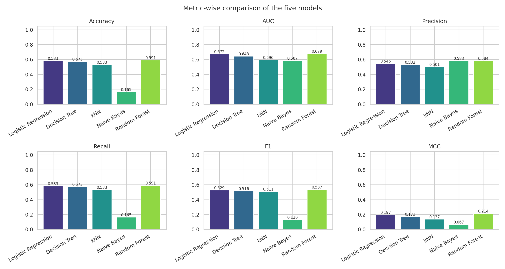

# Predicting Hospital Readmission of Diabetic Patients

**Machine Learning - Assignment 2 | Classification models compared on the Diabetes 130-US Hospitals dataset**


## 1. Problem Statement

When a diabetic patient is sent home and ends up back in hospital soon afterwards, it is usually bad news for the patient and
an expensive one for the hospital. If we could tell from the details of a hospital stay which patients are likely to return,
hospitals could give those patients extra follow-up care.

This project treats that as a classification problem. Using the records of a hospital stay (who the patient is, how long they
stayed, which tests and medicines they received, what they were diagnosed with), the goal is to predict whether the patient was
**readmitted within 30 days**, **readmitted after more than 30 days**, or **not readmitted at all**. Five different classification
models are trained on exactly the same prepared data and compared using six metrics: Accuracy, AUC, Precision, Recall, F1 and MCC.

---

## 2. Dataset Description

I used the **Diabetes 130-US Hospitals for Years 1999-2008** dataset from the UCI Machine Learning Repository. It holds hospital
records of diabetic patients collected across 130 US hospitals over ten years, with 101,766 encounters in total.

- Dataset page: https://archive.ics.uci.edu/dataset/296/diabetes+130-us-hospitals+for+years+1999-2008
- Licence: CC BY 4.0
- Citation: Clore, J., Cios, K., DeShazo, J., & Strack, B. (2014). *Diabetes 130-US Hospitals for Years 1999-2008* [Dataset].
  UCI Machine Learning Repository. https://doi.org/10.24432/C5230J

### Why I chose this dataset

I chose it for a few reasons. Predicting whether a patient comes back to hospital is a problem hospitals care about in practice, since
repeat admissions are expensive and often point to gaps in the care given during the first stay. The dataset is also well above the
size requirements, with 47 input features and over 100,000 rows. It has real missing values, which meant I had to make actual
decisions about how to handle them instead of just ticking a box. Finally, the classes are clearly imbalanced, which makes the
choice of evaluation metrics matter.

### Target variable

The target variable is `readmitted`, which has three classes: `<30` (readmitted within 30 days), `>30` (readmitted after more than
30 days) and `NO` (never readmitted). This makes the task a multi-class classification problem.

### Feature types

The raw file has 49 columns besides the target. Two of them are patient and encounter identifiers, which carry no medical meaning,
so I removed them. I also dropped `weight` because almost all of its values are missing. That leaves 46 model inputs, of which 8 are
numerical and 38 are categorical.

The numerical ones are counts such as days in hospital, number of lab procedures, number of medications and the number of earlier
outpatient, emergency and inpatient visits. The categorical ones cover demographics (race, gender, age band), admission and discharge
details, payer and medical specialty, three diagnosis columns with hundreds of different ICD-9 codes each, two lab-result columns,
and 25 columns about diabetes medication. Three columns look numeric but are really integer codes for admission type, discharge
disposition and admission source, so I treated them as categories.

### Class distribution

The classes are uneven. Of the 101,766 encounters in the raw file, 54,864 were never readmitted, 35,545 were readmitted after 30 days,
and 11,357 were readmitted within 30 days.

| Class | Meaning | Count | Share |
| --- | --- | --- | --- |
| `NO` | not readmitted | 54,864 | 53.9% |
| `>30` | readmitted after 30 days | 35,545 | 34.9% |
| `<30` | readmitted within 30 days | 11,357 | 11.2% |

The largest class is almost five times the size of the smallest. A model that always predicted "not readmitted" would already be right
about 54% of the time without learning anything. Because of this, I did not rely on accuracy alone. I also looked at AUC, MCC and how
well each model finds the small early-readmission group.


### Data preparation

- **Missing values.** The file marks missing values with `?`. I dropped `weight` (about 97% missing). For the remaining numerical
  columns I filled gaps with the median. For categorical columns such as `race`, `payer_code` and `medical_specialty` I gave missing
  values their own "Missing" category, because for columns with so many gaps the fact that a value is missing can itself be informative.
- **Duplicates and unusable rows.** I checked for duplicate rows and rows without a target value and removed them.
- **Encoding.** Categorical features were one-hot encoded. Categories used by fewer than 1% of rows were grouped together, so the
  diagnosis columns did not blow up into thousands of columns.
- **Scaling.** Numerical features were standardised, which matters for Logistic Regression and kNN.
- **Train-test split.** 80% training and 20% test, stratified on the target so both parts keep the same class proportions, with a fixed
  random seed of 42.
- **No data leakage.** All of the steps above are part of a scikit-learn `Pipeline`, so the medians, scaling values and category lists
  are learned from the training data only and then applied to the test data.

---

## 3. Repository and How to Run

GitHub repository: **https://github.com/2026ct05069/ML-Assignment-2**

```
ML-Assignment-2/
│
├── Model/
│   ├── 2026CT05069_ML_Assignment_...ipynb
│
├── Results/
│   ├── class_distribution.png
│   ├── confusion_matrices.png
│   ├── metrics_bar_chart.png
│   ├── metrics_heatmap.png
│   └── metrics_per_metric.png
│
├── README.md
├── requirements.txt
└── test_data.csv
```

To run it yourself:

```bash
pip install -r requirements.txt
```

Then open `model/ml_assignment_2_diabetes.ipynb` and run all cells from top to bottom. The notebook loads the dataset directly from
the UCI repository (dataset id 296) using the `ucimlrepo` package, so there is nothing to download by hand. An internet connection is
needed for that first step. Running the notebook also creates `test_data.csv`, the trained models in `model/saved/` and the tables
and graphs in `results/`.

---

## 4. Models Used

All five models were trained on the same training set and evaluated on the same test set. Since the target has three classes,
Precision, Recall and F1 are weighted averages over the classes, AUC is the one-vs-rest macro average, and MCC is the multi-class
version of the Matthews correlation coefficient.

| Model | Settings used |
| --- | --- |
| Logistic Regression | `max_iter=1000`, `C=0.1`, `random_state=42` |
| Decision Tree | `criterion="gini"`, `max_depth=4`, `min_samples_leaf=5`, `random_state=42` |
| kNN | `n_neighbors=101`, uniform weights, Euclidean distance |
| Naive Bayes | Gaussian Naive Bayes, `var_smoothing=0.1` |
| Random Forest (ensemble) | `n_estimators=200`, `max_depth=None`, `min_samples_leaf=2`, `random_state=42` |

### Comparison of the models (test set)

| **ML Model Name** | **Accuracy** | **AUC** | **Precision** | **Recall** | **F1** | **MCC** |
| --- | --- | --- | --- | --- | --- | --- |
| **Logistic Regression** | 0.5831 | 0.6727 | 0.5453 | 0.5831 | 0.5287 | 0.1973 |
| **Decision Tree** | 0.5748 | 0.6306 | 0.4947 | 0.5748 | 0.5212 | 0.1799 |
| **kNN** | 0.5748 | 0.6458 | 0.5461 | 0.5748 | 0.4996 | 0.1694 |
| **Naive Bayes** | 0.5607 | 0.6443 | 0.5205 | 0.5607 | 0.5066 | 0.1626 |
| **Random Forest (Ensemble)** | 0.5911 | 0.6793 | 0.5842 | 0.5911 | 0.5375 | 0.2143 |

### Graphs of all metrics





## 📊 Model Performance and Observations

| **ML Model Name** | **Observation about Model Performance** |
| :--- | :--- |
| **Logistic Regression** | Logistic Regression ranks second out of five on MCC (0.197), with test accuracy of 0.583, AUC of 0.673 and F1-score of 0.529. Its accuracy is only slightly above the 0.539 baseline of always predicting 'NO'. Training and test accuracy are close (gap: 0.003), indicating that the model is not overfitting. It identifies only 1.9% of the `<30` cases. As a linear model, it is fast and stable but cannot capture complex interactions between features. |
| **Decision Tree** | Decision Tree ranks third out of five on MCC (0.180), with test accuracy of 0.575, AUC of 0.631 and F1-score of 0.521. Its accuracy is only slightly above the 0.539 baseline. Training and test accuracy are close (gap: -0.001), indicating no significant overfitting. It identifies 0.0% of the `<30` cases. A single depth-limited tree is easy to interpret, but individual trees tend to be unstable. |
| **kNN** | kNN ranks fourth out of five on MCC (0.169), with test accuracy of 0.575, AUC of 0.646 and F1-score of 0.500. Its accuracy is only slightly above the 0.539 baseline. Training and test accuracy are close (gap: 0.009), indicating no significant overfitting. It identifies only 1.0% of the `<30` cases. With 205 encoded features, distances between patients become less meaningful due to the high dimensionality of the dataset. |
| **Naive Bayes** | Naive Bayes ranks fifth out of five on MCC (0.163), with test accuracy of 0.561, AUC of 0.644 and F1-score of 0.507. Its accuracy is only slightly above the 0.539 baseline. Training and test accuracy are close (gap: 0.004), indicating no significant overfitting. It identifies 11.6% of the `<30` cases, the highest among all five models. However, its assumptions of feature independence and bell-shaped distributions are not well suited to one-hot encoded and medication-related features. |
| **Random Forest (Ensemble)** | Random Forest ranks first out of five on MCC (0.214), with test accuracy of 0.591, AUC of 0.679 and F1-score of 0.537. Its accuracy is above the 0.539 baseline. Training accuracy is significantly higher than test accuracy (gap: 0.310), indicating substantial overfitting. It identifies only 0.9% of the `<30` cases. By combining multiple decision trees, it captures non-linear patterns and reduces variance. |
| **Overall Winner for This Dataset** | **Random Forest (Ensemble)** is the overall winner, achieving the highest MCC (0.214) and performing best across all six evaluation metrics. Logistic Regression comes second, with an MCC of 0.197, just 0.017 behind Random Forest. Although Random Forest performs best on unseen data, its training-test gap of 0.310 indicates substantial overfitting. Furthermore, none of the five models performs well at identifying early readmissions (`<30`), with the best detection rate being 11.6% from Naive Bayes. |

### 🏆 Overall Conclusion

Random Forest (Ensemble) is the best-performing model for this dataset based on the overall evaluation metrics, particularly MCC, which is useful for evaluating an imbalanced multi-class classification problem.

However, its training-test accuracy gap of 0.310 indicates substantial overfitting. Its test accuracy of 0.591 is also only moderately higher than the baseline accuracy of 0.539.

More importantly, all five models struggle to identify early readmissions (`<30`). Naive Bayes achieves the highest detection rate at just 11.6%.

**Conclusion:** Random Forest is the overall winner, but class imbalance and poor minority-class detection remain major challenges that require further improvement.


### Things to keep in mind

All models were run once on a single train-test split with fairly standard settings, so models with very close scores could swap places
with a different seed or with tuning. Also, the same patient can appear in several rows (several hospital stays), so a patient may end up
in both the training and the test set, which can make the scores slightly optimistic.
